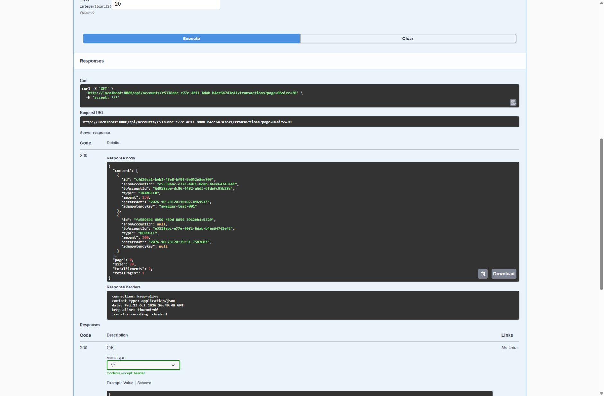

# Banking Transaction API demo

This walkthrough uses simulated funds and disposable local accounts. It demonstrates the service's behavior through Swagger UI, including duplicate protection and an unsuccessful withdrawal.

## Recorded local results

Verified on October 23, 2026 using the running Spring Boot application and PostgreSQL 16.

| Step | Action | Observed result |
| --- | --- | --- |
| 1 | Create Alice and Bob through `POST /api/accounts` | Both requests return 201 with zero balances |
| 2 | Deposit 500 into Alice's account | 200 with a deposit transaction |
| 3 | Transfer 150 from Alice to Bob using key `swagger-test-001` | 200 with a transfer transaction |
| 4 | Execute the identical transfer request again | 200 with the original transaction ID and timestamp |
| 5 | Attempt to withdraw 700 from Alice | 409 with `Insufficient funds` |
| 6 | Retrieve both accounts | Alice has 350; Bob has 150 |
| 7 | Retrieve Alice's transaction history | Exactly two entries: deposit 500 and transfer 150 |

The rejected withdrawal creates no history entry, and the replay does not move money a second time.



## Reproduce in Swagger

1. Start the app using the README instructions and open <http://localhost:8080/swagger-ui/index.html>.
2. Expand `POST /api/accounts`, select **Try it out**, and execute `{"ownerName":"Alice"}`. Copy the returned `id`. Repeat with Bob.
3. Expand `POST /api/accounts/{id}/deposits`, enter Alice's ID, and execute `{"amount":500.00}`.
4. Expand `POST /api/transfers` and substitute the actual account IDs into the request below. Use a fresh key for a new demo run.

```json
{
  "fromAccountId": "ALICE_ID",
  "toAccountId": "BOB_ID",
  "amount": 150.00,
  "idempotencyKey": "swagger-demo-new-run-001"
}
```

5. Execute that identical transfer twice. Both responses should have the same transaction ID.
6. Use Alice's ID in `POST /api/accounts/{id}/withdrawals` with `{"amount":700.00}`. Expect 409.
7. Use `GET /api/accounts/{id}` for each account to verify balances of 350 and 150.
8. Use Alice's ID in `GET /api/accounts/{id}/transactions` to verify `totalElements: 2`.

For an automated live demonstration, run `scripts/demo.ps1`. It creates fresh accounts, checks duplicate-transfer replay and final balances, and prints the sender's history. The overdraft check is covered in the Swagger walkthrough and automated API tests.

## Automated verification

Initial local `mvnw.cmd -B verify` results:

| Database | Tests | Failures | Errors | Skipped |
| --- | ---: | ---: | ---: | ---: |
| H2 in PostgreSQL compatibility mode | 21 | 0 | 0 | 0 |
| PostgreSQL 16 through Testcontainers | 21 | 0 | 0 | 0 |
| Total | 42 | 0 | 0 | 0 |

The checks include simultaneous withdrawals, opposing transfers, concurrent duplicate requests, conflicting global idempotency keys, and rollback after modified balances have been flushed to SQL but transaction-history storage fails. This is correctness verification, not a throughput benchmark or production certification.

Run `mvnw.cmd verify` on Windows or `sh ./mvnw verify` on macOS/Linux with JDK 21 and Docker running. The latest hosted results and downloadable test reports are available in the repository's **Actions** tab.
